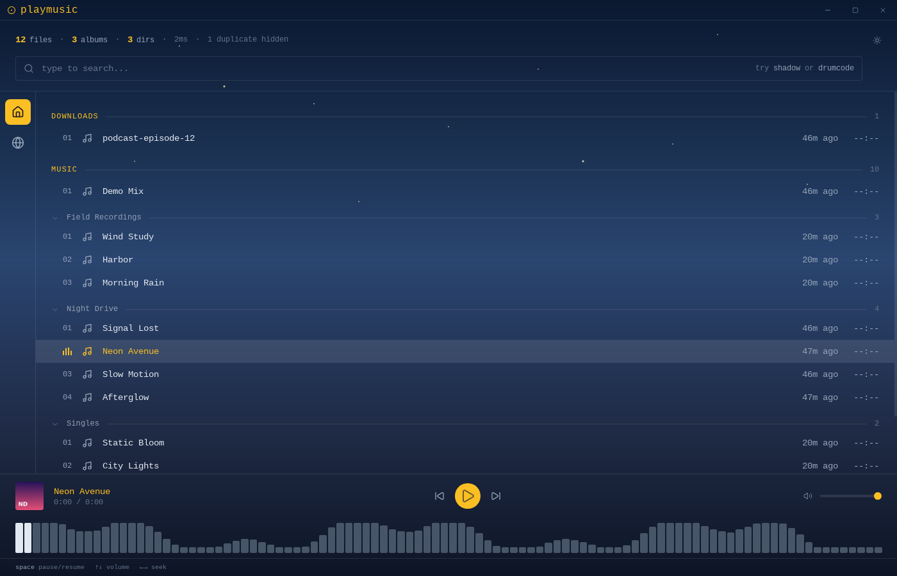
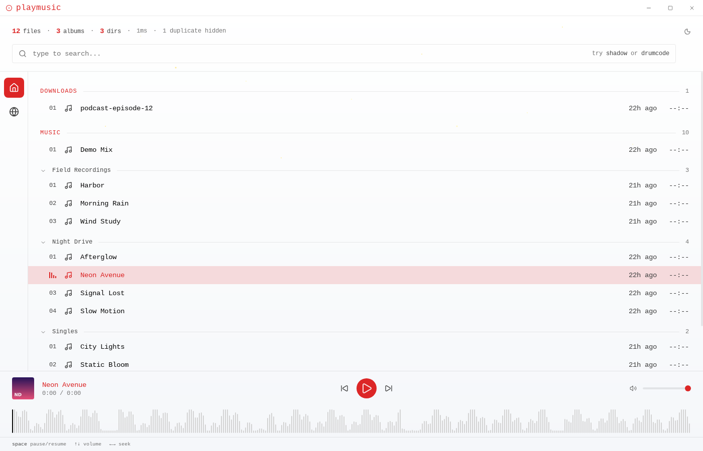
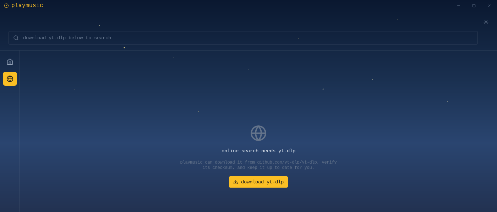

# PlayMusic Desktop

A desktop media player for the music and videos already on your computer, built with Tauri, React and
Rust. It finds media in your usual folders, groups it by folder and album, and plays it with a
waveform-based player. An optional Online space adds YouTube search and streaming.

It's the desktop companion to [PlayMusic](https://github.com/samuaks/playmusic), a Go/Bubble Tea
terminal player, and is meant as a learning-friendly codebase (the repository is named
`musical-palm-tree`). Windows is the primary target; macOS and Linux builds are also published.



## What it does

**Local library**

- On startup, scans `~/Downloads`, `~/Music`, `~/Videos`, `~/Desktop` and `~/Documents`, up to three
  folder levels deep, for audio (mp3, flac, wav, aac, ogg, m4a) and video (mp4, mkv, webm, avi, mov).
- Groups files by top-level folder, then album (the first subfolder). The library fills in while
  the scan is still running.
- Fuzzy search across file, album and folder names.
- Collapsible albums; which ones are collapsed is remembered.
- Duplicate detection: files with the same size and the same first and last 4 KiB are listed once
  (the first copy found), and the header shows how many duplicates were hidden.

**Player**

- Plays audio and video. Next/previous follow the library order, and the next track starts when one
  ends.
- Cover art for the current track: the picture embedded in the file (mp3, flac, ogg, m4a), or else a
  `cover`, `folder`, `front` or `album` image (jpg/png) in the track's folder. YouTube thumbnails for
  online tracks.
- Waveform overview in the player bar: click to seek, hover to preview the position. It's built in
  Rust from the first 60 seconds of the track. Until it's ready, and for tracks that have none
  (online streams, unsupported codecs), a plain progress line does the same job.
- Videos play in a resizable pane on the right; fullscreen with `F`, a double-click, or the
  fullscreen button. The player bar can be resized too.

**Online space (optional)**

- YouTube search (top 10 results) and audio-only streaming through
  [yt-dlp](https://github.com/yt-dlp/yt-dlp). Not needed for local files; see
  [Online space](#online-space-optional) below.

**App**

- Light and dark themes, custom title bar.
- Theme, volume, last-used space, collapsed albums, and pane sizes persist between sessions.

| Light theme                                                          | Online space before yt-dlp is installed                                     |
| -------------------------------------------------------------------- | --------------------------------------------------------------------------- |
|  |  |

<sub>Screenshots are from a Linux build with a generated demo library, which is why durations show
`--:--` (see [Known limitations](#known-limitations)).</sub>

## Keyboard shortcuts

These work while nothing else has keyboard focus (click an empty area after using the search box).

| Key       | Action                        |
| --------- | ----------------------------- |
| `Space`   | Play / pause                  |
| `←` / `→` | Seek 5 seconds back / forward |
| `↑` / `↓` | Volume up / down              |
| `F`       | Toggle fullscreen (videos)    |

## Known limitations

- **Local playback doesn't work on Linux.** WebKitGTK fails to load media served through Tauri's
  asset protocol (`FormatError`), so local tracks don't play and durations stay `--:--`. Seen on
  Ubuntu 24.04 with WebKitGTK 2.52.6. Scanning, search and waveforms still work. Windows and macOS
  use different web engines (WebView2, WKWebView), so this is specific to Linux.
- The scanned folders are fixed, and the library is only scanned at startup.
- Tracks within an album are listed in filesystem order, not sorted by name.
- Duplicates are only counted; there's no view of which files they are.
- The waveform reflects the first 60 seconds of a track, stretched across the whole track.
- Online streams are audio-only.

## Supported formats

Playback uses the platform's web engine (WebView2 on Windows, WKWebView on macOS, WebKitGTK on
Linux), so which formats and codecs actually play depends on the platform. Waveforms are generated
in Rust with [symphonia](https://github.com/pdeljanov/Symphonia):

| Format                                 | Waveform                                                         |
| -------------------------------------- | ---------------------------------------------------------------- |
| mp3, flac, wav, aac, ogg (Vorbis), m4a | ✅                                                               |
| mp4, mov                               | ✅ (AAC audio)                                                   |
| mkv, webm                              | ✅ with AAC, Vorbis or FLAC audio; ❌ with Opus (common in webm) |
| avi                                    | ❌                                                               |

## Getting started

Requirements:

- [Bun](https://bun.sh) and Node.js (versions pinned in `mise.toml`)
- Rust (stable, via `rustup`)
- Windows: Microsoft C++ Build Tools · macOS: Xcode Command Line Tools · Linux:
  `libwebkit2gtk-4.1-dev libgtk-3-dev librsvg2-dev libsoup-3.0-dev build-essential libssl-dev`

```bash
bun install
bun run tauri dev      # run the app in development
bun run tauri build    # installers in src-tauri/target/release/bundle/
```

Tests and lint (Rust):

```bash
bun run build          # once: tauri-build needs dist/ to exist
cd src-tauri
cargo test
cargo clippy --all-targets
```

There's no CI for tests yet, so run these before opening a pull request.

## Online space (optional)

The Online space needs yt-dlp. The easiest way to get it is in the app: open the Online space and
click **download yt-dlp**. playmusic downloads the official standalone build for your platform,
checks it against the release's `SHA2-256SUMS`, and stores it in its app data folder (no admin
rights needed). It then checks for a newer yt-dlp once a day, and right away if a search or stream
fails, since YouTube changes regularly break older versions.

- **Release installers** already include yt-dlp. When that bundled copy falls behind, playmusic
  downloads the newer one the same way and uses it instead.
- **Your own yt-dlp** (`winget install yt-dlp.yt-dlp`, `brew install yt-dlp`, `pipx install yt-dlp`)
  is found on your `PATH` and left for you to update.
- **To bundle it in your own build**, put the binary at `src-tauri/binaries/yt-dlp-<target-triple>`
  and build with `bun run tauri build --config src-tauri/tauri.bundle-yt-dlp.conf.json`.

## Releases

Pushing to the `release` branch runs `.github/workflows/publish.yml`, which builds installers for
macOS (Apple Silicon and Intel), Linux and Windows and publishes them as a GitHub release tagged
`app-v<version>`. Each build bundles the latest yt-dlp, verified against its checksums. Day-to-day
work happens on `main`; don't commit directly to `release`.

## How it's built

React owns the UI and state (Zustand), Tauri IPC connects it to Rust, and Rust does the heavy
filesystem and media work: scanning, hashing, cover-art thumbnails, waveform decoding, and managing
yt-dlp. Waveforms are generated in Rust because the browser's `decodeAudioData` decodes a whole file
into memory first (about 800 MB for a 38-minute stereo track), which crashed the WebView on long
files.

- [`ARCHITECTURE.md`](./ARCHITECTURE.md): how the pieces fit together, with a suggested reading order
- [`CLAUDE.md`](./CLAUDE.md): conventions, commands, and gotchas (written for AI agents, useful for
  people too)

## Contributing and forks

Forks are welcome as a way to try ideas before they're ready for a pull request: a new library
layout, player controls, the video pane, online search, scan performance, themes, or small
Rust/Tauri commands. When bringing work back, keep pull requests small, explain the change, include
screenshots for UI changes, and say how you verified it.

## Roadmap

| Item                                           | Status      |
| ---------------------------------------------- | ----------- |
| Custom scan folders via a settings UI          | Planned     |
| Show cover art in the library too              | Planned     |
| Autocomplete dropdown with keyboard navigation | Planned     |
| Playlists                                      | Planned     |
| Shuffle / loop modes                           | Planned     |
| Contributor-friendly fork workflow docs        | Planned     |
| Network streaming from a custom API            | Researching |
| Mobile builds (Tauri 2 iOS / Android)          | Researching |
