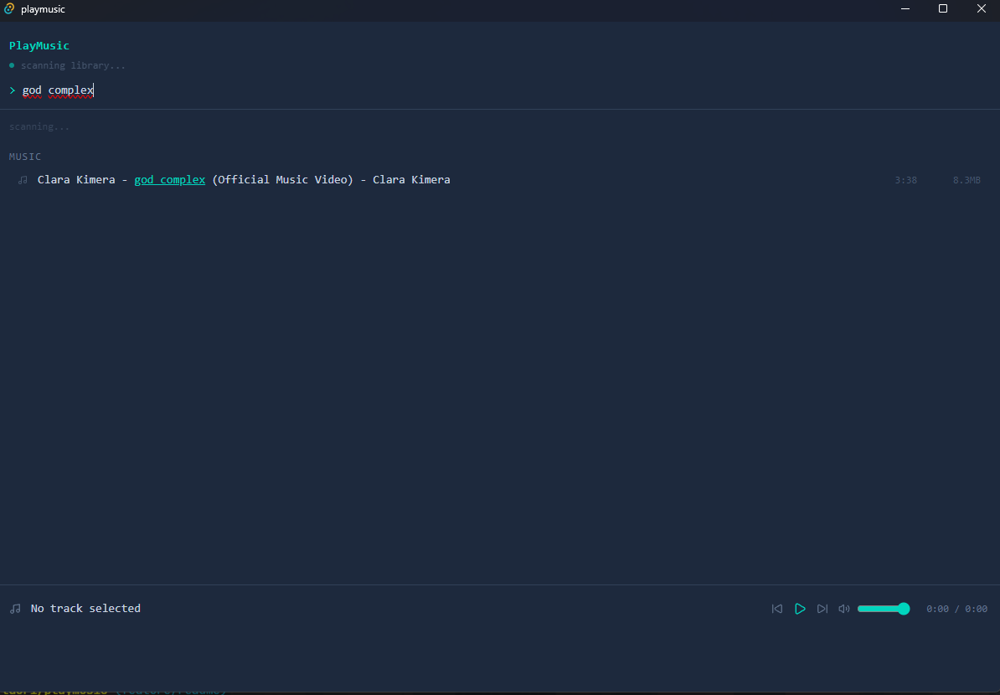
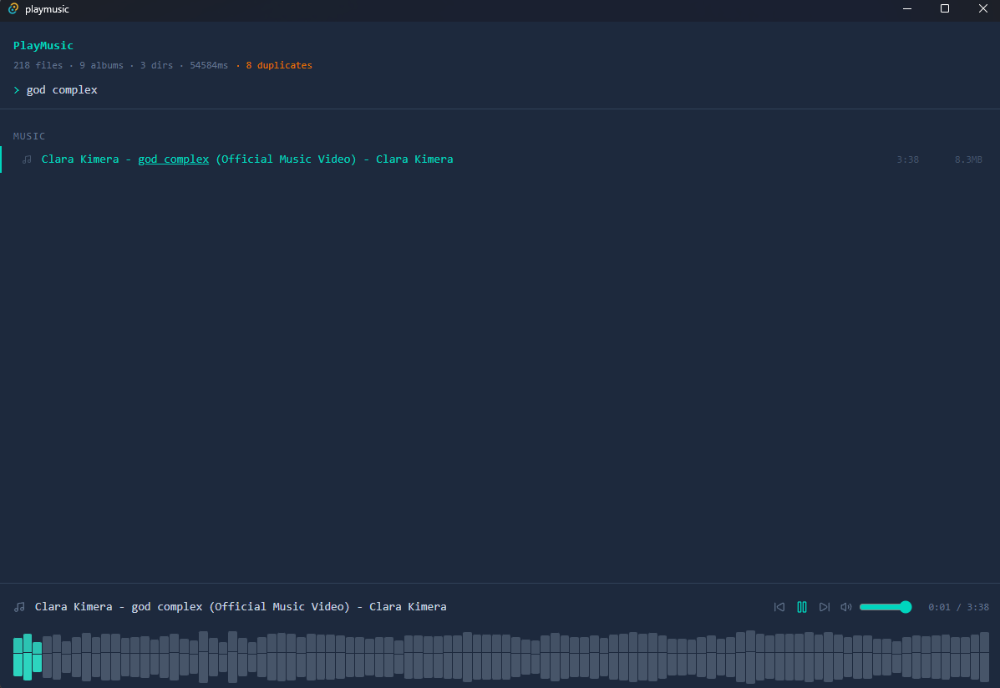
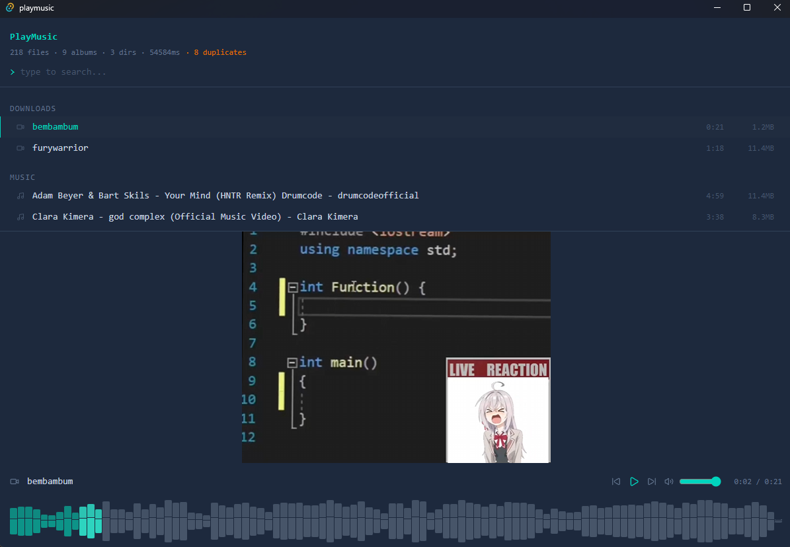

# PlayMusic Desktop

A cross-platform desktop media player built with Tauri, React, and Rust, and a companion project in the PlayMusic ecosystem. It scans your home directory for audio and video files, groups them by folder, and plays them with a keyboard-driven waveform UI inspired by terminal aesthetics.

## Relationship to PlayMusic

PlayMusic Desktop is a desktop companion project in the PlayMusic ecosystem. The repository is currently named `musical-palm-tree`.

The main [PlayMusic](https://github.com/samuaks/playmusic) repository focuses on a Go/Bubble Tea terminal media player. This project explores the same media-player domain through a desktop stack: Tauri, React, TypeScript, and Rust.

Together, the projects offer complementary learning paths:

- PlayMusic: Go, terminal UI, playback architecture, CLI/TUI workflows
- PlayMusic Desktop: desktop UX, React state, Tauri IPC, Rust-backed media processing

This repository is especially fork-friendly: contributors can experiment with UI, playback, scanning, and desktop interaction ideas in their own forks, then bring small, well-explained improvements back through pull requests.

## Screenshots

### Library view


### Waveform view


### Video playback


## Features

- Scan of `~/Downloads`, `~/Music`, `~/Videos`, `~/Desktop` and `~/Documents` (up to 3 levels deep) on startup
- Automatic grouping by top-level directory → subfolder → file
- Incremental UI updates streamed from Rust via Tauri events as files are found
- Fuzzy search across filenames, albums, and directory names via `fuse.js`
- Duplicate detection via partial MD5 hashing of file size + start/end bytes
- Collapsible album sections with persisted state via `localStorage`
- Soundcloud-style mirrored waveform visualizer with click-to-seek
- Resizable player bar with drag handle that also hosts the video viewport
- Support for audio (mp3, flac, wav, aac, ogg) and video (mp4, mkv, webm, avi, mov)
- Native keyboard shortcuts (space, arrows) with scoped focus handling
- Embedded cover art extracted via `lofty` and cached; durations read lazily from `<audio>` metadata
- Online space: YouTube search and streaming via `yt-dlp`, which the app can download and keep updated
- Waveform generation server-side via `symphonia` to avoid WebView crashes on large files

## Supported Formats

| Format | Audio | Video | Waveform |
|---|---|---|---|
| mp3 | ✅ | | ✅ |
| flac | ✅ | | ✅ |
| wav | ✅ | | ✅ |
| aac | ✅ | | ✅ |
| ogg | ✅ | | ✅ |
| mp4 | | ✅ | ✅ (audio track) |
| mkv | | ✅ | partial |
| webm | | ✅ | partial |
| avi | | ✅ | partial |
| mov | | ✅ | partial |

## Roadmap

| # | Description | Type | Status |
|---|---|---|---|
| 1 | Fuzzy search via `fuse.js` | Feature | Done |
| 2 | Collapsible album sections | Feature | Done |
| 3 | Persistent collapsed state | Feature | Done |
| 4 | Incremental scan streaming | Feature | Done |
| 5 | Duplicate detection (partial hash) | Feature | Done |
| 6 | Waveform visualizer | Feature | Done |
| 7 | Video playback with resizable viewport | Feature | Done |
| 8 | Custom scan directories via settings UI | Feature | Planned |
| 9 | Parallel metadata reading with `rayon` | Perf | Done |
| 10 | Autocomplete dropdown with keyboard nav | Feature | Planned |
| 11 | Playlist support | Feature | Planned |
| 12 | Shuffle / loop modes | Feature | Planned |
| 13 | Network streaming from custom API | Feature | Researching |
| 14 | Mobile builds (Tauri 2.0 iOS / Android) | Feature | Researching |
| 15 | Headphone removal auto-pause | Feature | Not possible without native platform APIs |
| 16 | Contributor-friendly fork workflow docs | Docs | Planned |

## Usage

Development:
```bash
bun install
bun run tauri dev
```
Production build:
```bash
bun run tauri build
```

Produces platform-native installers in `src-tauri/target/release/bundle/`.

Tests (Rust unit tests):
```bash
cd src-tauri
cargo test
```
`tauri-build` needs a `dist/` folder to exist before any `cargo` command (run `bun run build` once);
see `CLAUDE.md` for details.

## Learning and Forks

This project is designed to be useful as a learning open-source codebase. Forks are welcome as a normal way to explore ideas before they are ready for a focused pull request.

Good fork-sized experiments include:

- trying a new library layout
- improving player controls
- changing the video pane UX
- experimenting with online search
- improving scan performance
- refining themes and visual states
- adding small Rust/Tauri commands

When bringing work back, prefer small pull requests with a clear explanation, screenshots for UI changes, and simple verification notes.

## Hotkeys

- `space` — pause / resume
- `←` / `→` — seek 5 seconds
- `↑` / `↓` — adjust volume
- `enter` in search — (planned: play if one result)
- click waveform — seek to position
- click track — play immediately

## Online space (optional)

The Online space (YouTube search and streaming) uses [yt-dlp](https://github.com/yt-dlp/yt-dlp).
You don't need it to build or run the app; local files work without it.

The easiest way to enable it is in the app: open the Online space and click **download yt-dlp**.
playmusic downloads the official standalone build for your platform from the latest yt-dlp release,
checks it against the release's `SHA2-256SUMS`, and stores it in its app data folder (no admin rights
needed, on Windows, macOS and Linux). It then checks for a new yt-dlp release once a day, and right away
if a search or stream fails, since YouTube changes regularly break older versions. Release installers
already include yt-dlp; when that bundled copy falls behind, playmusic downloads the newer one the same
way and uses it instead.

If you already manage yt-dlp yourself (`winget install yt-dlp.yt-dlp`, `brew install yt-dlp`,
`pipx install yt-dlp`), playmusic finds it on your `PATH` and leaves updating it to you. To ship it
inside an installer instead, put the binary at `src-tauri/binaries/yt-dlp-<target-triple>` and build with
`bun run tauri build --config src-tauri/tauri.bundle-yt-dlp.conf.json`.

## Requirements

- Bun 1.1+
- Node 20+ (uses node:fs)
- Rust (stable, managed via `rustup`)
- On Windows: Microsoft C++ Build Tools
- On macOS: Xcode Command Line Tools
- On Linux: `webkit2gtk-4.1`, `build-essential`, `libssl-dev`

## Architecture

### Rust (src-tauri)

- `scanner.rs` — `WalkDir`-based recursive scan, builds nested Directory/Album/MediaFile tree, emits `scan_count` per chunk and throttled `scan_progress` tree snapshots, returns `ScanResult` with metadata + duplicates
- `waveform.rs` — `symphonia` decoder reads the first 60 seconds of audio and downsamples to 100 normalized `f32` bars
- `online.rs` — `search_online` / `resolve_stream` commands, parse yt-dlp's JSON output
- `ytdlp.rs` — finds, installs (verified download), updates and runs the optional yt-dlp
- `lib.rs` — Tauri entry point, command and plugin registration

### React (src)

- `App.tsx` — top-level shell: titlebar, header, space sidebar, active space, video pane, player bar
- `spaces/` — Local and Online spaces, registered in `spaces/index.tsx`
- `store.ts` — Zustand store: playback queue, per-space state, collapsed albums (persisted to localStorage)
- `components/Library.tsx` — renders the directory tree with collapsible albums, fuzzy-filtered via `useMemo`
- `components/PlayerBar.tsx` — playback UI, resizable, hosts video element
- `hooks/useScan.ts` — listens to scan events, invokes `scan_media`
- `hooks/useAudioPlayer.ts` — unified audio/video playback, seek, keyboard shortcuts, online stream resolving
- `hooks/useWaveform.ts` — invokes Rust `generate_waveform` command
- `hooks/useResizable.ts` — generic drag-to-resize logic
- `hooks/usePlayer.ts` — next/prev through the store queue
- `utils/filterDirs.ts` — fuzzy search via weighted Fuse index

### IPC

- JS → Rust: `invoke('scan_media')`, `invoke('generate_waveform', { path })`, `invoke('search_online', { query })`, `invoke('resolve_stream', { videoId })`
- Rust → JS: `emit('scan_progress', directories)` — tree snapshot at most every 250 ms during scan; `emit('scan_count', n)` — files merged so far

## Why Tauri over Electron

- ~10MB binary instead of 150MB+
- Rust backend for filesystem scanning and audio decoding — faster and more memory-safe than Node for heavy work
- Same webview-based frontend developer experience
- Native webview on each platform (WebView2, WKWebView, WebKitGTK)

## Why server-side waveform generation

The browser's `AudioContext.decodeAudioData` loads the full file into memory as raw PCM before any processing can begin. A 38-minute stereo track decodes to roughly 800MB of floats, which crashes the WebView process on large files.

Moving waveform generation to Rust with `symphonia` bounded memory usage to the decoded portion (first 60s) regardless of file size, while also producing cleaner output via native format parsers.

## Releases

Pushing to the `release` branch runs `.github/workflows/publish.yml`, which builds installers for
macOS (Apple Silicon and Intel), Linux and Windows and publishes them as a GitHub release tagged
`app-v<version>`. Each build downloads the latest yt-dlp release for its platform, checks it against
yt-dlp's `SHA2-256SUMS`, and bundles it (via `src-tauri/tauri.bundle-yt-dlp.conf.json`), so the Online
space works out of the box. Day-to-day work happens on `main`; don't commit directly to `release`.